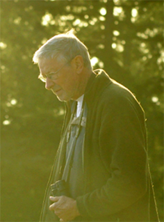

## Harvey’s footsteps

<figure class="galiano-harvey-portrait"></figure>

```{r, echo=FALSE, message=FALSE, warning=FALSE}
library(dplyr)
plants <- read.csv("tabular_data/Galiano_Tracheophyta_catalogue_2025-12-30-selected-labels.csv")
harvey <- plants %>% filter(grepl("Janszen", recordedBy))
harvey.years <- range(as.integer(substr(harvey$eventDate, 1, 4)), na.rm = TRUE)
```

This project is dedicated to the memory of Harvey Janszen (July 11, 1946–May 10, 2021) and other fellow naturalists, including Hans Roemer, who have passed away in recent years. Harvey spent decades getting to know the plants of the Salish Sea—collecting more than 3000 plant specimens, keeping field journals from 1973 to 2017, and compiling species checklists for the southern Gulf Islands, the Saanich Peninsula, and the San Juan Islands.

Galiano Island was part of Harvey’s botanical life from his very first journal, which records collections from Galiano alongside those of Saturna and the neighbouring islands, through to his later inventories of the island’s rock bluffs and meadows. His *Outer Gulf Islands Vascular Plant Checklist* (2003) remains a cornerstone of this flora: together with his specimens, it accounts for `r nrow(harvey)` of the records in this atlas, documenting `r length(unique(harvey$taxon_name))` of Galiano’s plants between `r harvey.years[1]` and `r harvey.years[2]`. The photograph above was taken on Galiano Island on May 3, 2019.

Through the [Janszen Legacy Project](https://imerss.github.io/janszen-legacy-storymap/Janszen_Legacy_Project.html) we continue to digitize Harvey’s journals and collections, and through this atlas we invite you to help carry his work forward, by sharing your local plant knowledge and contributing to the co-creation of a living *Flora of Galiano Island.*

<!-- TODO: the Galiano project's supporters - their logos go in static/local/images/supporters/, listed as for Saanich:
<div class="galiano-supporters">
<p class="galiano-supporters-title">With thanks to our supporters</p>
<ul class="galiano-supporters-list">
<li class="galiano-supporter-NAME"></li>
</ul>
</div>
-->

```{r, echo=FALSE, message=FALSE, warning=FALSE}
source("scripts/Janszen_checklists_mapbox.R")
janszenChecklistsMap
```
